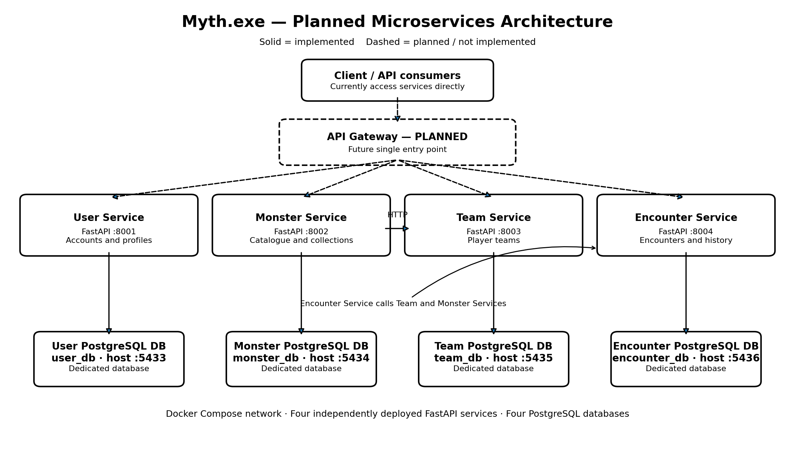

# Myth.exe

Myth.exe is a FastAPI-based microservices application for a monster-collection and encounter game. The system consists of four independently deployed microservices, each with its own PostgreSQL database, orchestrated using Docker Compose.

## 1. Group Information

**Group name:** Myth.exe

| # | Full name | University email |
|---|---|---|
| 1 | Samitha Piumanga Michael | s.michael@studenti.unipi.it |
| 2 | Abhinav Das | a.das6@studenti.unipi.it |
| 3 | Sara Xxx | s.xxx10@studenti.unipi.it |
| 4 | Ebin Neelankavil Lenin | e.neelankavillenin@studenti.unipi.it |

## 2. Architecture

The application currently consists of four microservices:

- **User Service:** User registration, login and profiles.
- **Monster Service:** Monster catalogue and player collections.
- **Team Service:** Player teams and team validation.
- **Encounter Service:** Encounter resolution and encounter history.

Each service owns a separate PostgreSQL database. Services communicate with one another through HTTP requests over the Docker network.

### Architecture Diagram



The API Gateway is included in the planned architecture but has not yet been implemented. Currently, clients access the four services directly through their individual ports.

### Service Overview

| Service | Port | Responsibility |
|---|---:|---|
| User Service | 8001 | User accounts and profiles |
| Monster Service | 8002 | Monster catalogue and collections |
| Team Service | 8003 | Player teams |
| Encounter Service | 8004 | Encounters and history |
| API Gateway | Planned | Central entry point for service requests |

### Database Overview

| Database | Host port | Database name | Database user |
|---|---:|---|---|
| User database | 5433 | `user_db` | `user_service` |
| Monster database | 5434 | `monster_db` | `monster_service` |
| Team database | 5435 | `team_db` | `team_service` |
| Encounter database | 5436 | `encounter_db` | `encounter_service` |

## 3. OpenAPI Specifications

The following OpenAPI JSON specifications are available in the `docs/` directory:

- [User Service OpenAPI](docs/user-service-openapi.json)
- [Monster Service OpenAPI](docs/monster-service-openapi.json)
- [Team Service OpenAPI](docs/team-service-openapi.json)
- [Encounter Service OpenAPI](docs/encounter-service-openapi.json)
- [API Gateway OpenAPI — Planned](docs/api-gateway-openapi.json)

**Important:** The API Gateway OpenAPI document describes a proposed API contract. The API Gateway itself is not implemented or currently accessible.

### Interactive Swagger Documentation

FastAPI provides interactive Swagger UI for each implemented service:

| Service | Swagger UI |
|---|---|
| User Service | http://localhost:8001/docs |
| Monster Service | http://localhost:8002/docs |
| Team Service | http://localhost:8003/docs |
| Encounter Service | http://localhost:8004/docs |

## 4. Implementation Status

The following table summarizes the current implementation status.

| Functionality | Status |
|---|---|
| User registration | Implemented |
| User login | Implemented |
| User profile retrieval | Implemented |
| Monster catalogue | Implemented |
| Player monster collection | Implemented |
| Monster acquisition through encounters | Implemented |
| Team creation | Implemented |
| Team validation and monster limits | Implemented |
| Team replacement and removal | Implemented |
| Team power calculation | Implemented |
| Available encounter listing | Implemented |
| Encounter resolution | Implemented |
| Encounter result details | Implemented |
| Encounter history | Implemented |
| Player progress persistence | Implemented; end-to-end verification pending |
| Complete monster image coverage | Partially implemented |
| API Gateway | Planned |
| Graphical frontend | Not implemented |
| HTTPS configuration | Not implemented |

The backend currently provides the main functionality for user management, monster collections, team management and encounter processing.

The encounter service calculates encounter difficulty and resolves outcomes using the implemented game rules. Successful encounters can reward players with the corresponding monster.

The API Gateway, graphical frontend and HTTPS configuration remain future development tasks.

## 5. Requirements

Install the following before running the project:

- Docker Desktop or Docker Engine with Docker Compose
- Git
- Python 3.13 or newer for local development and testing

## 6. Running the Application

### 6.1 Clone the Repository

```bash
git clone https://github.com/samithamichael98/monster-tamers.git
cd monster-tamers
```

### 6.2 Configure Environment Variables

Create a `.env` file in the project root. Configure the required variables using your local credentials.

```dotenv
POSTGRES_PASSWORD=your_postgres_password

USER_DB_PASSWORD=your_user_db_password
MONSTER_DB_PASSWORD=your_monster_db_password
TEAM_DB_PASSWORD=your_team_db_password
ENCOUNTER_DB_PASSWORD=your_encounter_db_password

JWT_SECRET_KEY=your_long_random_jwt_secret
```

Do not commit real database passwords or JWT secrets to GitHub.

### 6.3 Build and Start the Services

```bash
docker compose up --build -d
```

Check the container status:

```bash
docker compose ps
```

View all service logs:

```bash
docker compose logs -f
```

View an individual service log:

```bash
docker compose logs -f user-service
```

### 6.4 Check Service Health

```bash
curl http://127.0.0.1:8001/health
curl http://127.0.0.1:8002/health
curl http://127.0.0.1:8003/health
curl http://127.0.0.1:8004/health
```

Each service should return a healthy response.

## 7. API Endpoints

### User Service — Port 8001

| Method | Endpoint | Description |
|---|---|---|
| `GET` | `/health` | Check service health |
| `POST` | `/register` | Register a user |
| `POST` | `/login` | Authenticate a user |
| `GET` | `/me` | Retrieve the authenticated user's profile |

### Monster Service — Port 8002

| Method | Endpoint | Description |
|---|---|---|
| `GET` | `/health` | Check service health |
| `GET` | `/monsters` | List all monsters |
| `GET` | `/monsters/{monster_id}` | Retrieve monster details |
| `GET` | `/players/{player_id}/collection` | Retrieve player collection |
| `POST` | `/players/{player_id}/collection` | Add a monster to a collection |

### Team Service — Port 8003

| Method | Endpoint | Description |
|---|---|---|
| `GET` | `/health` | Check service health |
| `POST` | `/players/{player_id}/teams` | Create a team |
| `GET` | `/players/{player_id}/teams` | List player teams |

### Encounter Service — Port 8004

| Method | Endpoint | Description |
|---|---|---|
| `GET` | `/health` | Check service health |
| `GET` | `/encounters/available` | List available encounters |
| `POST` | `/encounters` | Resolve an encounter |
| `GET` | `/players/{player_id}/encounters` | Retrieve encounter history |

For request parameters and response schemas, refer to the individual OpenAPI specifications.

## 8. Example API Request

The following example creates an encounter using player 1, team 4 and wild monster 4.

```bash
curl -X POST http://127.0.0.1:8004/encounters \
  -H "Content-Type: application/json" \
  -d '{
    "player_id": 1,
    "team_id": 4,
    "wild_monster_id": 4
  }'
```

The backend calculates encounter difficulty automatically. It is not supplied by the client.

## 9. Running Tests

The project includes automated tests for the four microservices.

From the project root, create and activate a virtual environment:

```bash
python3 -m venv .venv
source .venv/bin/activate
```

Install dependencies:

```bash
python -m pip install -r requirements.txt
```

Run the complete test suite:

```bash
python -m pytest -v
```

The tests use isolated test databases and mock service interactions where appropriate. Required environment variables must be configured for service imports.

## 10. Stopping the Application

Stop containers while preserving database data:

```bash
docker compose down
```

To stop containers and permanently delete database volumes:

```bash
docker compose down -v
```

Use the second command only when you intentionally want to reset all local database data.

## 11. Troubleshooting

### Containers Are Not Healthy

Check the service status and logs:

```bash
docker compose ps
docker compose logs --tail=100 user-db user-service
```

Make sure `.env` exists and contains all required variables.

### Password Authentication Failed

PostgreSQL stores credentials in its persistent volume. If the password in `.env` was changed after a database volume was created, the existing database may still use the old password.

Restore the original password or intentionally recreate the local database volumes:

```bash
docker compose down -v
docker compose up --build -d
```

### Port Already in Use

Stop the process using the port, or change the host-side port mapping in `docker-compose.yml`. Do not change the container ports used for service-to-service communication.

## 12. Additional Information

- Each microservice is independently deployed.
- Each microservice owns its own PostgreSQL database.
- Docker Compose manages the services and their database containers.
- Service-to-service communication uses HTTP.
- The API Gateway and graphical frontend are planned but not yet implemented.
- The project is under active development, and some functionality remains incomplete.

This repository represents the current development state of Myth.exe for the second optional submission. The implementation status is documented to support review and feedback.